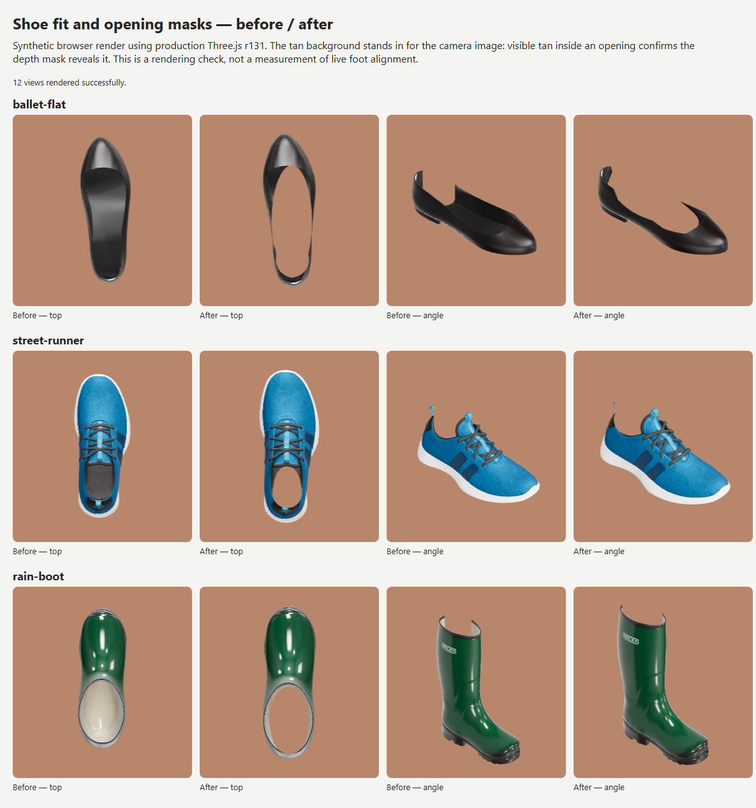

# Shoe calibration and foot locking

## Implemented and verified

Blender MCP on port 9876 was used to import and inspect the models. The existing
scene was kept separate from the new `ShoeFit-*` scenes. All models were already
within the performance budgets, and inspection found no loose/zero-area geometry
to remove. Decimation was deliberately avoided to preserve silhouette and detail.

All four samples now have version 2
`scene.extras.tryOnFit`: heel, toe, sole and ankle-opening anchors in normalized
glTF metres, plus capped masks built from ordered elliptical cross-sections.
The canvas sneaker also has an authored collar mask and nine tracker reference
guides in its Blender scene, matching the other samples.
The runtime fits anchors first, then applies the existing admin calibration.
Unprofiled or malformed uploads use the original bounding-box fit and generic
mask. Boot masks begin inside the cuff and extend above it, preserving the lower
shaft. The flat mask follows the long instep opening and narrows into the ankle;
the runner mask follows its collar. Corrected heel/toe anchors avoid using the
boot shaft's rear extent or the runner's outsole overhang as foot length.
These are authored approximations, not measured shopper-specific leg silhouettes.

| Model | Triangles (before / after) | Bytes before | Bytes after | Brotli bytes |
| --- | ---: | ---: | ---: | ---: |
| Street runner | 22,700 / 22,700 | 979,696 | 980,508 | 801,327 |
| Canvas sneaker | 8,720 / 8,720 | 409,708 | 410,384 | 309,727 |
| Ballet flat | 12,800 / 12,800 | 385,740 | 386,688 | 265,950 |
| Rain boot | 14,032 / 14,032 | 466,712 | 467,376 | 377,261 |

The geometry and texture SHA-256 hashes, material counts, and variant names match
the baseline. Textures remain at most 1024 px; meshes remain indexed with floating
point attributes. Machine-readable reports live in `resources/models/optimized`.

The live Blender MCP validation is recorded in `blender-validation.json`: all
four saved scenes match their geometry checksums and JSON profiles, have nine
tracker guides, and contain no loose vertices or zero-area faces. Scenes must be
evaluated before checking world-space geometry. Fit profiles and `.blend` files
were re-exported through MCP, with the original Blender scene restored afterwards.

`scripts/precompress.mjs` now includes GLB files. The four shoes transfer 18–31%
fewer bytes with Brotli (490,691 bytes saved in total); gzip is also generated.
Both formats were decompressed and compared byte-for-byte with the GLBs.
The existing production Caddy configuration serves these copies automatically.
This reduces download size; it does not reduce GPU triangle counts or prove FPS.

The pose solver checks the native solver's success flag, rejects nonfinite and
tiny landmark sets, and refines perspective reprojection error with bounded
work. At most one drifting landmark may be excluded, using eight remaining
observations and at most two additional native solves. Incorrect finite poses
are hidden. The debug overlay reports reprojection error and rejection reasons.
Foot-side detection no longer forces screen-space ordering, and rotations around
the camera axis are allowed. These settings still need real-phone validation.

Bare feet now use the smaller `NN_BAREFOOT_3` network by default. The intro offers
"Bare feet" and "Socks or shoes" before starting; custom server defaults remain
available. Snapshot requests during tracking loss show the positioning hint.

The tracker now gates visibility on a finite, accepted pose; requires at least
two observations spanning 32 ms to acquire; and hides every rejected/missing
frame. Independent per-slot pose filters retain history across gaps shorter than
150 ms, then reset and reacquire. Large translation/rotation jumps are rejected,
and chirality/network changes reset both landmark and pose filters. Filtering is
time-based, using adaptive translation smoothing and quaternion interpolation.
It does not freeze shoes on screen when tracking is unavailable.

Camera projection uses the cover crop and a focal length derived from the source
video's minimum dimension. The same focal length drives PnP and the renderer.
Landmark smoothing uses actual CSS canvas dimensions, including capped DPR.
Resize, camera flip, tab suspension/resume and tuning changes reset stale poses.
The attached floor shadow is removed because there is no measured floor plane.

## Automated checks

`npm test` covers the fit math, metadata fallback, calibrated masks, filtering,
invalid poses, jumps, reacquisition, independent feet, and 30/60 FPS behavior.
All 37 JavaScript tests pass. Native PnP tests use both shipped foot networks,
covering 48 combinations of mirrored feet, rotations and focal lengths. Tests
execute the vendored r131 GLTF loader and
tracker helper, including material
variant switching, chirality resets, canvas clearing and portrait/landscape
projection. Browser image decoding is stubbed in the Node loader test; image
dimensions and decoding are checked separately with Sharp. This is not GPU or
live-camera validation. Version 2 tests also check closed/indexed mask topology,
mirrored and calibrated sections, invalid-profile fallback, and rays through real
model openings: masks reveal the interiors while preserving toe uppers and the
lower boot shaft. Synthetic stationary-noise tests verify reduced noise;
they do not establish real-world tracking accuracy.

The earlier implementation also rendered twelve before/after views in headless
Chrome using the production r131
GLTF loader, lighting and fitting code. All views rendered without reported
errors. The new masks add 256 triangles for the runner/boot and 320 for the flat;
each shoe plus its mask still uses two draw calls. This is a desktop software
rendering check, not a phone FPS measurement.

Tan represents the camera layer; the comparison demonstrates the revealed
openings and preserved uppers. It contains no live foot or tracking measurements.

The production build passed. PHP configuration syntax passed, but the installed
Composer dependencies omit the development test runner: `php artisan test`
reports that the command is unavailable. No PHP feature-suite result is claimed.
An additional Laravel bootstrap/Blade render smoke check passed for asset version
4, both installed network options and their download sizes, and the intro control.

## Phone acceptance: not yet measured

No reference phones or recorded test clips were available during implementation.
Acquisition time, valid-pose coverage, visual registration error, device FPS and
false-positive rate therefore have **no measured before/after result yet**.
The 0.8 threshold, 33-degree source FOV and DPR cap are unchanged;
new tracking constants are initial defaults, pending this acceptance pass.

On Android Chrome and iPhone Safari, record the phone/browser/camera and test bare
feet and socks under the same lighting, distance and framing. Use both live video
and identical local clips through `?demo=/path/to/clip.mp4&debug=1`. Include:

- Ten seconds still, slow turns, lifting a foot, and moving both feet.
- Crossing feet, brief/long occlusion, leaving/re-entering the frame, and no feet.
- Portrait/landscape, camera flip, tab resume, all products and colourways, photos.
- Dim light and patterned floors; check false positives rather than only scores.

Compare to the previous commit on the same device/clip. Targets: at least 30%
lower stationary jitter, 95% accepted-pose coverage during well-lit stationary
and slow motion, reacquisition within 500 ms, median 25 FPS or higher, and no
increase in false positives. Measure jitter against manually checked foot
landmarks in screen space, normalized by foot length, not raw camera translation.
Do not call these targets passed until the measurements exist.

## Rebuild and rollback

See `resources/models/optimized/README.md` for Blender authoring and export.
Original source models are untouched. To compare without authored metadata, run
`node scripts/prepare-sample-models.mjs --stage`; baseline GLBs are written only
to `storage/app/model-build/input`. Full runtime rollback uses the previous
commit's helper, JS, and sample GLBs together, followed by an asset-version bump.

The default asset version is now `4`. Existing installations overriding
`TRYON_ASSET_VERSION` must change that value too and refresh their config cache
when deploying. Nothing was deployed and no database records were changed.

The vendored helper has local changes for visibility, filter resets and
projection. Preserve these patches and their integration tests on vendor updates.
